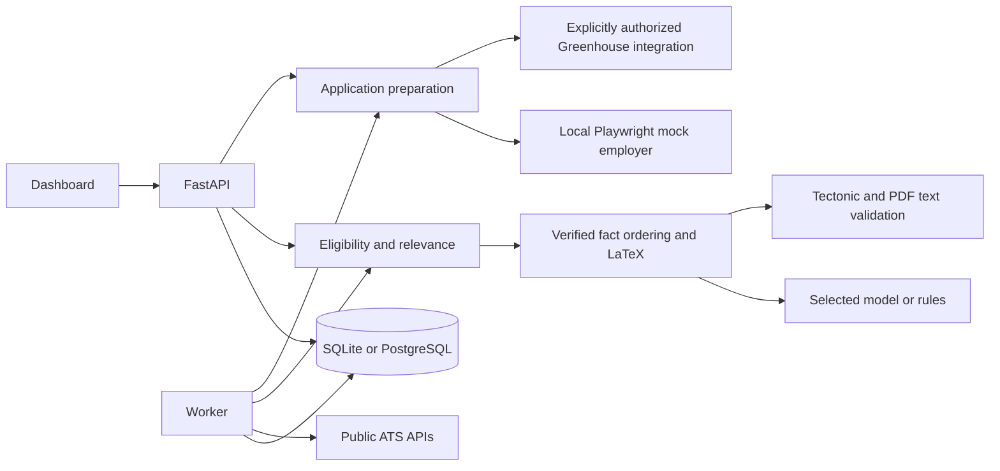

# Architecture

The dashboard uses native ES modules and CSS, served by FastAPI. This keeps browser entry points and auth same-origin and makes native installation independent of a frontend build. Source preferences and applicant facts use typed JSON in SQL. Jobs, source observations, JD revisions, resume versions, applications, events, receipts, runs, and logs have separate relations. Alembic owns schema changes. Uploaded originals and generated PDFs are private database blobs. Source observations record independent liveness so a duplicate listing can remain available through another live board.

Manual intake and scheduled discovery share normalization, matching, resume generation, and preparation. The scheduler queues persistent runs and serializes admission through a settings row. A renewable worker lease prevents concurrent run claims. Canceled runs stop between bounded operations. An interrupted run can be recovered once, and generation and preparation deduplicate durable job records. Hourly due times are stored in UTC and formatted with the selected IANA timezone. Preparation and approved dispatch are distinct operations.

Required details and incomplete eligibility evidence go through a deterministic rules service. Relevance is computed from verified skills and supporting projects, experience, education, preferences, and title alignment. The model ranks existing fact IDs. Verified text supplies the final rendered content, so the model cannot fabricate credentials or inject TeX. The templates keep the evidence and vary typography and spacing. The editor can change the geometry margin while the claim corpus remains fixed. The compiler validates presence, extractability, page limits, and expected facts, and records overflow warnings.

Application preparation chooses a local Playwright fixture, a manual handoff, or supported employer API preflight. The form preview records field names and any missing labels. The mock submission verifies the actual attached PDF against the selected version and stores a durable one-time receipt. An authorized employer API submission requires an existing approval and unchanged job, profile, and form data. A compare-and-set status transition precedes the POST. Outcomes with ambiguous receipt state are held for reconciliation instead of retried. Scheduled dispatch considers only already-approved applications.

The system uses public ATS endpoints as its discovery runtime and career-ops' vendored ATS detector for official URL routing. See [Open-source reuse](OPEN_SOURCE_REUSE.md).
